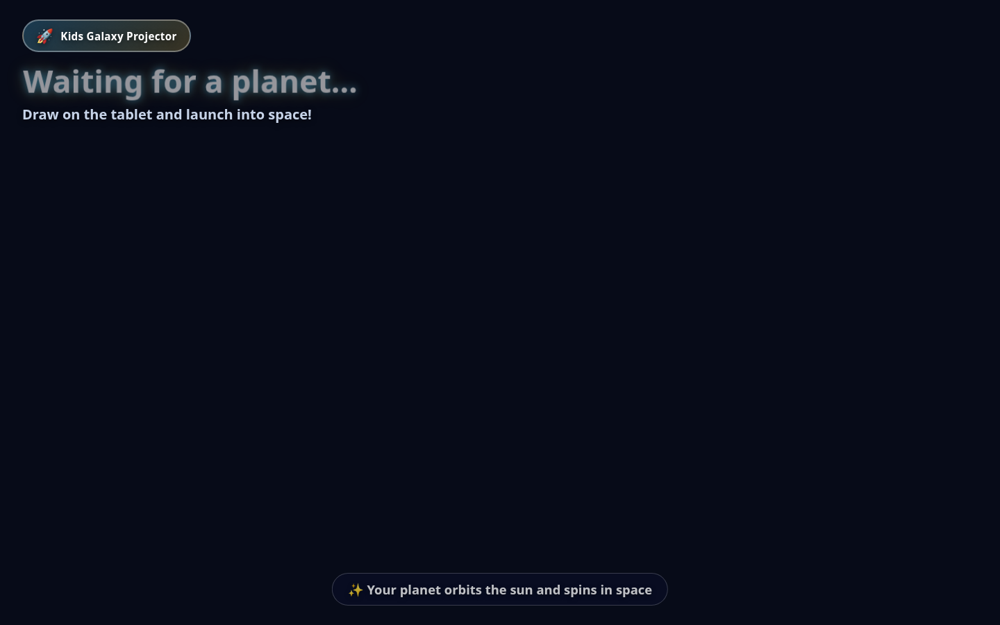

# Install the Kids Galaxy room

This page is for daycare educators.
Parents and teachers can use it too.
It is not the programmer guide.
Programmer notes stay in `DEVELOPMENT.md`.

The first setup takes about two hours.
A morning at a daycare takes about ten minutes after that.
Do one step at a time.
Check the screen after each step.

This room uses one Windows 11 PC.
The PC version is 26H2.
Ubuntu 22.04 runs inside it.
The Linux user is `omega`.
Docker starts with Ubuntu.
A travel router goes to every daycare.
Young children use the kid tablet.

<!-- section: who -->

## Who this page is for

You can do this if you can plug in a cable and paste one line.
A helper is useful the first time you share a tablet.
Children should not do the first setup.

<!-- section: words -->

## Words we use

**Galaxy computer.** The Windows PC that makes the wall picture.
Open the app named Ubuntu when a step says to paste a line.

**Ubuntu.** The app on this PC where you paste lines.
The name on the line is `omega`.
Windows calls this setup WSL. You can ignore those letters.

**Projector.** The box that shines the picture on the wall.

**Travel router.** The small box you bring to every daycare.
Its Wi-Fi name is `KidsGalaxy`.
The PC address on that Wi-Fi is `192.168.0.52`.

**Kid tablet.** The tablet children draw on.

**Manager tablet.** The tablet a grown-up uses.
It can remove planets, print, and clear names before you leave.

**Docker Desktop.** A Windows app that must stay closed.
Docker inside Ubuntu is the one this room uses.

**USB share.** The program `usbipd`.
It lets Ubuntu see a tablet plugged into the PC.
Ubuntu cannot see that cable by itself.

**Paper card.** The sheet with the Wi-Fi name, the password, and the PC address.

**HDMI.** The flat metal plug on the picture cable.

<!-- section: buy -->

## What to have ready

Gather every item before setup day.

<!-- step: buy-kid-tablet -->

1. One Android tablet for the children.
   It must be Android 8 or newer.
   A 10 inch screen is easier for small hands.
   It must allow a full erase.

   **What you should see.** The box names Android 8 or newer.

   **If not.** Pick another tablet before setup day.

<!-- step: buy-manager-tablet -->

2. One Android tablet for a grown-up.
   It follows the same rules as the kid tablet.
   Do not plan to lock this one.

   **What you should see.** The tablet turns on.

   **If not.** Charge it with its own charger.

<!-- step: buy-computer -->

3. Use the Windows 11 PC for this room.
   It needs HDMI, or USB-C plus an HDMI adapter.
   It must open Chrome.
   You do not buy a second computer.

   **What you should see.** Windows shows a desktop.

   **If not.** Ask a helper before setup day.

<!-- step: buy-router -->

4. One travel router.
   This room uses the one set to `KidsGalaxy`.
   It must reserve `192.168.0.52` for this PC.
   The first router setup is on the production page.

   **What you should see.** The router can run from USB-C or a power bank.

   **If not.** Use the production page before the first visit.

<!-- step: buy-projector -->

5. One projector with an HDMI port.
   Brighter is better if the room lights stay on.

   **What you should see.** The projector has an HDMI port.

   **If not.** Buy a projector that has one.

<!-- step: buy-hdmi -->

6. One HDMI cable long enough to reach the projector.
   Buy a USB-C to HDMI adapter if the PC has no HDMI port.

   **What you should see.** The plug fits the projector.

   **If not.** Take it back and get the right plug.

<!-- step: buy-power -->

7. Power cables for the PC, the projector, and both tablets.
   Bring two tablet chargers.

   **What you should see.** Each device has its own power cord.

   **If not.** Do not share a tiny phone charger with the kid tablet.

<!-- step: buy-wifi -->

8. The travel router is the only network.
   Do not use the daycare Wi-Fi.
   Leave the Windows hotspot off.
   That hotspot always uses `192.168.137.1`.
   It often will not start with no internet to share.
   It also turns off when the last tablet leaves.

   **What you should see.** The paper card says `KidsGalaxy` and `192.168.0.52`.

   **If not.** Fill in the card before you leave home.

<!-- step: buy-usb -->

9. One USB cable that can carry data.
   A charge-only cable will not set up a tablet.

   **What you should see.** The package says data, or it is the cable from the tablet box.

   **If not.** Buy a data cable before setup day.

<!-- section: unpack -->

## Unpack the box

About 15 minutes.

<!-- step: unpack-check -->

1. Put each item on a table.
   Check off the list above.

   **What you should see.** Every item is on the table.

   **If not.** Stop until the missing cable or power block is found.

<!-- step: unpack-charge -->

2. Plug both tablets into their chargers.

   **What you should see.** A battery picture on each tablet.

   **If not.** Swap the cable and seat it firmly.

<!-- section: place -->

## Put things in the room

About 20 minutes.

<!-- step: place-wall -->

1. Pick a blank wall the children can see.
   Keep bright windows out of the picture if you can.

   **What you should see.** A clear space on the wall.

   **If not.** Shift the projector until the beam hits a blank area.

<!-- step: place-projector -->

2. Put the projector on a steady table.
   Point it at the wall.
   Leave space so nobody walks through the beam.

   **What you should see.** The projector sits still.

   **If not.** Move it off a soft chair or a wobbly cart.

<!-- step: place-computer -->

3. Put the PC next to the projector.
   Plug HDMI into the PC and the projector.

   **What you should see.** Both plugs are fully in.

   **If not.** Push each plug until it stops.

<!-- step: place-router -->

4. Plug in the travel router.
   Use wall power or the power bank.
   Do not plug it into the daycare network.

   **What you should see.** A steady Wi-Fi light on the router.

   **If not.** Check the power plug or the power bank.

<!-- step: place-power -->

5. Plug the PC and the projector into wall power.
   Turn both on.
   Press the source button until the projector says HDMI.

   **What you should see.** The Windows desktop is on the wall.

   **If not.** Try the other HDMI port or a second cable.

<!-- step: place-wifi -->

6. On the PC, open the Wi-Fi list.
   Join `KidsGalaxy`.
   Use the password on the paper card.
   Do not join the daycare Wi-Fi.

   **What you should see.** The Wi-Fi name is `KidsGalaxy`.

   **If not.** Forget the other networks, then join `KidsGalaxy` again.

<!-- photo: room-layout -->

> **Photo needed:** the projector facing a blank wall, with the PC beside it.

<!-- photo: hdmi-plug -->

> **Photo needed:** a finger pushing the HDMI plug into the projector until it stops.

<!-- fix: place -->

> **If this does not work**
>
> 1. Check both power lights.
> 2. Push the HDMI plug in until it clicks.
> 3. Press the source button until it says HDMI.
> 4. If the Wi-Fi name is not `KidsGalaxy`, stop and join that network.

<!-- section: computer -->

## Start the galaxy computer

About 30 minutes the first time.
Paste one line at a time.
Press Enter after each line.

<!-- step: computer-docker -->

1. Quit Docker Desktop before any setup line.
   If you see a whale icon, right-click it.
   Choose Quit Docker Desktop.
   Open Windows Startup apps.
   Turn off Docker Desktop so it does not start at sign-in.

   **What you should see.** The whale icon is gone.

   **If not.** Setup will stop while Docker Desktop is still running.

<!-- step: computer-ubuntu -->

2. Click Start, type `Ubuntu`, and open that app.

   **What you should see.** A window with the name `omega`.

   **If not.** Close the window and open Ubuntu again. Do not use a window that says `root`.

<!-- photo: terminal -->

> **Photo needed:** the Ubuntu window with the name omega.

<!-- step: computer-folder -->

3. Paste this line.

```bash
cd /home/omega/kids-galaxy-projector
```

   Then paste this line.

```bash
pwd
```

   **What you should see.** `/home/omega/kids-galaxy-projector`

   **If not.** You are in the wrong folder. Paste the first line again.

<!-- step: computer-address -->

4. Paste this line.

```bash
hostname -I
```

   **What you should see.** `192.168.0.52`

   **If not.** The PC is on the wrong network.
   Join `KidsGalaxy` on Windows.
   Run `wsl --shutdown` in PowerShell, open Ubuntu, and check again.
   Do not continue until you see `192.168.0.52`.

<!-- step: computer-host -->

5. Paste this line.

```bash
bash scripts/setup_host.sh
```

   Type the Ubuntu password for `omega` if it asks.
   You will not see the letters.

   **What you should see.** `The galaxy computer programs are installed.`

   **If not.** If Docker Desktop is still running, the line stops.
   You should see `Docker Desktop is running on Windows.`
   Quit Docker Desktop, then paste the same line again.

<!-- step: computer-reopen -->

6. Close the Ubuntu window.
   Open Ubuntu again from Start.

   **What you should see.** The name `omega` is back.

   **If not.** Restart the PC, sign in, and open Ubuntu again.

<!-- step: computer-return -->

7. Paste this line again.

```bash
cd /home/omega/kids-galaxy-projector
```

   **What you should see.** No error.

   **If not.** Paste `pwd` and check the folder before you go on.

<!-- step: computer-setup -->

8. Paste this line.

```bash
bash scripts/setup_room.sh
```

   Wait. The first run can take several minutes.

   **What you should see.** `The galaxy computer is running.`
   You should also see `https://192.168.0.52:8443`.
   Write that address on the paper card.

   **If not.** If the PC is not at `192.168.0.52`, setup stops.
   The tablets keep `192.168.0.52`.
   Join `KidsGalaxy`, then run the same line again.
   Do not change the address unless a helper means to move the room.
   That helper uses `CHANGE_ADDRESS=1` and a new `SERVER_IP`.
   Then the tablet apps must be built again.

<!-- step: computer-spare -->

9. Leave the Windows hotspot off.
   Do not paste the Linux hotspot script.
   Ubuntu refuses that script because it does not own the Wi-Fi card.

   **What you should see.** The PC stays on `KidsGalaxy`.

   **If not.** Turn the Windows hotspot off and join `KidsGalaxy` again.

<!-- fix: computer -->

> **If this does not work**
>
> 1. Read the last lines in Ubuntu. They name the missing piece.
> 2. If Docker Desktop is running, quit it and run the host line again.
> 3. If the address is not `192.168.0.52`, join the travel router.
> 4. Setup keeps the tablet address. It does not follow a daycare network.

<!-- section: picture -->

## Show the picture

About 5 minutes.
Stay in the project folder.

<!-- step: picture-open -->

1. Paste this line.

```bash
bash scripts/open_projector.sh
```

   Chrome opens on Windows.

   **What you should see.** A dark sky and the words `Kids Galaxy Projector`.
   A desktop shortcut named `Kids Galaxy wall` is also created.

   **If not.** On Windows, open Chrome and go to `http://127.0.0.1:8000/`.

<!-- step: picture-full -->

2. Press F11 if the picture does not fill the wall.

   **What you should see.** The waiting words are on the wall.

   **If not.** Press the Windows key and P. Choose Second screen only.

<!-- photo: projector-words -->



The stars fill the rest of the wall when the picture is live.
This photo shows the words only, so you can check the language.

<!-- fix: picture -->

> **If this does not work**
>
> 1. On Windows, open `http://127.0.0.1:8000/health`.
>    You should see the word ok.
> 2. If you do not, go back to the project folder and run `bash scripts/setup_room.sh`.
> 3. Check the HDMI cable and the projector source button.

<!-- section: usb -->

## Let Ubuntu see the tablet

Do this before you install an app.
A tablet plugged into the PC is not visible in Ubuntu until you share it.
You only install the share program once.
You attach the tablet each time you plug it in.

<!-- step: usb-admin -->

1. Right-click Start and open Terminal (Admin) or PowerShell (Admin).

   **What you should see.** The title says Administrator.

   **If not.** Close it and open the admin window again.

<!-- step: usb-install -->

2. Paste this line once.

```powershell
winget install --exact --id dorssel.usbipd-win --accept-package-agreements --accept-source-agreements
```

   **What you should see.** The install finishes.

   **If not.** Choose Yes if Windows asks. Then paste the line again.

<!-- step: usb-ubuntu -->

3. Open Ubuntu and leave that window open.

   **What you should see.** The name `omega`.

   **If not.** The share step needs Ubuntu to be awake.

<!-- step: usb-plug -->

4. Plug the data cable into the tablet and the PC.
   Use the same USB port each time.

   **What you should see.** The tablet shows a charge picture or a USB notice.

   **If not.** Try another port and a data cable.

<!-- step: usb-allow -->

5. On the tablet, tap Allow.

   **What you should see.** A check that USB debugging is allowed.

   **If not.** Unlock the tablet and tap Allow again.

<!-- step: usb-list -->

6. In the admin PowerShell window, paste this line.

```powershell
usbipd list
```

   **What you should see.** A line for the tablet, with a short code such as `2-1`.

   **If not.** Unplug the tablet, plug it in again, and paste the line again.

<!-- step: usb-bind -->

7. Write that code on the paper card.
   Paste the next line with your code in place of `2-1`.

```powershell
usbipd bind --busid 2-1
```

   **What you should see.** The command finishes.
   This line does not print a list.

   **If not.** The window is not an admin window.

<!-- step: usb-bind-list -->

8. Paste this line again.

```powershell
usbipd list
```

   **What you should see.** The tablet line says Shared.

   **If not.** Check the code on the paper card and run the bind line again.

<!-- step: usb-attach -->

9. Paste the next line with the same code.

```powershell
usbipd attach --wsl --busid 2-1 --distribution Ubuntu
```

   **What you should see.** The command finishes.
   This line does not print a list.

   **If not.** Open Ubuntu, then paste the attach line again.

<!-- step: usb-attach-list -->

10. Paste this line again.

```powershell
usbipd list
```

   **What you should see.** The tablet line says Attached.

   **If not.** Paste the attach line again, then paste `usbipd list` again.

<!-- step: usb-see -->

11. In Ubuntu, paste this line.

```bash
adb devices
```

   **What you should see.** A line that ends with `device`.

   **If not.** Tap Allow on the tablet, attach again, and paste `adb devices` again.

<!-- fix: usb -->

> **If this does not work**
>
> 1. Only one tablet may be plugged in.
> 2. If Ubuntu says no tablet is ready, repeat the attach step.
> 3. Use the same USB port so the code on the paper card still works.

<!-- section: tablets -->

## Set up the tablets

About 40 minutes the first time.
Skip this part if both apps are already installed.
Every Ubuntu line starts in the project folder.

<!-- step: tablets-skip -->

1. Look at each tablet.
   The kid tablet should show the drawing app.
   The manager tablet should show Kids Galaxy Manager.
   If both are there, go to the lock section.

   **What you should see.** The two apps are already installed.

   **If not.** Continue with the next step.

<!-- step: tablets-build -->

2. Paste this line.

```bash
cd /home/omega/kids-galaxy-projector && bash scripts/build_tablets.sh
```

   The first build can take about 30 minutes.

   **What you should see.** `BUILD SUCCESSFUL`

   **If not.** If Android tools are missing, a helper must install Android Studio.

<!-- step: tablets-kid -->

3. Erase the kid tablet.
   Skip every account.
   Join `KidsGalaxy` when the tablet asks.
   Open Settings, then About tablet, and tap Build number seven times.
   Go back, open Developer options, and turn on USB debugging.
   Share that tablet with Ubuntu, as in the USB section.
   Paste this line.

```bash
bash scripts/prepare_kid_tablet.sh
```

   **What you should see.** The drawing app fills the screen.

   **If not.** If the line says no tablet is ready, repeat the attach step.
   If lock mode fails, erase the tablet and do not sign in.

<!-- step: tablets-manager -->

4. Unplug the kid tablet.
   Plug in the manager tablet and tap Allow.
   Share it with Ubuntu the same way.
   Do not erase this tablet unless you want to.
   Paste this line.

```bash
bash scripts/prepare_manager_tablet.sh
```

   **What you should see.** Kids Galaxy Manager is in the app list.
   This tablet is not locked.

   **If not.** Use a data cable and tap Allow. Only one tablet may be plugged in.

<!-- fix: tablets -->

> **If this does not work**
>
> 1. Share the tablet, then look for a line that ends with `device`.
> 2. If lock mode fails, erase the kid tablet and do not sign in.
> 3. If the app closes at once, run `bash scripts/setup_room.sh`, then build the apps again.

<!-- section: lock -->

## Lock the kid tablet

About 15 minutes.
Do this only on the kid tablet.
The prepare line already turns lock mode on.
Use this section if you need to do it again.

<!-- step: lock-erase -->

1. Erase the kid tablet.
   Skip every account.
   Join `KidsGalaxy`.

   **What you should see.** A home screen with no email account.

   **If not.** Erase the tablet again.

<!-- step: lock-share -->

2. Turn on USB debugging.
   Plug in the kid tablet alone.
   Tap Allow.
   Attach it to Ubuntu with the USB share steps.

   **What you should see.** `adb devices` ends with `device`.

   **If not.** Repeat the attach step before you go on.

<!-- step: lock-command -->

3. In the project folder, paste this line.

```bash
bash scripts/prepare_kid_tablet.sh
```

   Press Home.

   **What you should see.** You stay in the drawing app.

   **If not.** Erase the tablet, skip the account, and run the line again.

<!-- photo: lock-screen -->

> **Photo needed:** the kid tablet showing only the drawing app, with no home icons.

<!-- fix: lock -->

> **If this does not work**
>
> The usual cause is an account on the tablet.
> Erase the tablet again.
> Do not sign in.
> Run the same command again.

<!-- section: first-planet -->

## Send the first planet

About 10 minutes.
The kid tablet must be on `KidsGalaxy`.

<!-- step: first-draw -->

1. On the kid tablet, tap a shape and draw a few lines.

   **What you should see.** Your marks on the tablet.

   **If not.** Wake the tablet and open the drawing app.

<!-- step: first-launch -->

2. Tap Launch.
   Look at the wall.

   **What you should see.** The new planet in the sky.
   The first planet can take a few seconds.

   **If not.** Check that the tablet Wi-Fi name is `KidsGalaxy`.

<!-- fix: first-planet -->

> **If this does not work**
>
> 1. The tablet and the PC must both show `KidsGalaxy`.
> 2. Do not use the daycare Wi-Fi.
> 3. Read the troubleshooting page if the wall stays empty.

<!-- section: time -->

## How long each part takes

| Part | First time | Later |
| --- | --- | --- |
| Unpack and place | 35 minutes | 10 minutes |
| Galaxy computer | 30 minutes | 5 minutes |
| Picture | 5 minutes | 1 minute |
| Tablet share and apps | 55 minutes | Skip |
| First planet | 10 minutes | 2 minutes |

The next page is the daily guide.
Use it after this setup works once.

<!-- section: next -->

## When the room must last

<!-- step: next-production -->

1. Read the production page after the first planet works.
   It covers the router reservation, safety copies, and updates.

   **What you should see.** You can find the travel router section on that page.

   **If not.** Stay on this page until the first planet appears.

<!-- step: next-kid -->

2. Read the kid tablet page before children use the tablet.
   It covers the case, lock mode, and charging.

   **What you should see.** You can follow that page on its own.

   **If not.** Do the case and lock steps there before a child uses the tablet.
