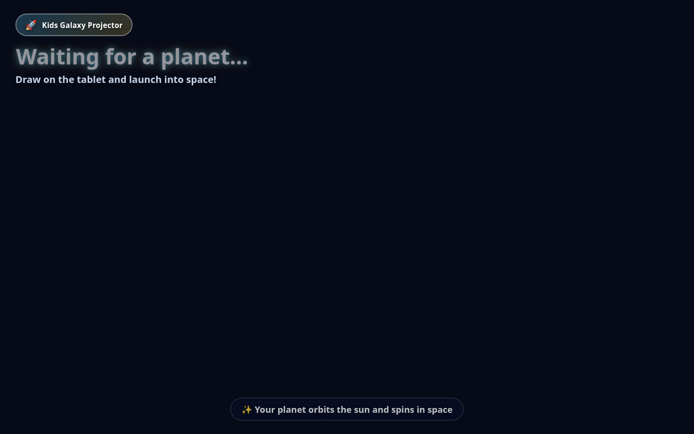

# Install the Kids Galaxy room

This page is for parents, teachers, and daycare staff.
It is not the programmer guide.
Programmer notes stay in `DEVELOPMENT.md`.

The first setup takes about two hours.
A normal morning takes about ten minutes after that.
Do one step at a time.
Do not skip a step that says you should see something.

<!-- section: who -->

## Who this page is for

You can do this if you can plug in a cable and copy one line.
A helper is useful for the tablet steps.
Children should not do the first setup.

<!-- section: words -->

## Words we use

**Galaxy computer.** The laptop or desktop that makes the picture.
A Raspberry Pi can be this computer.
A laptop gives a smoother picture.

**Projector.** The box that shines the picture on the wall.

**Kid tablet.** The tablet children draw on.
The drawing app stays on the screen.

**Manager tablet.** The tablet a grown-up uses.
It can delete planets, print, and change the wall language.

**Lock mode.** The kid tablet cannot open other apps.

**Certificate.** A small ID card for one tablet.
A child never types it.

**Wi-Fi.** The wireless link in the room.
The computer and the tablets must join the same one.

**Terminal.** The window where you paste one command.
Open it from the app list. It may be called Terminal.

**HDMI.** The flat metal plug on the picture cable.

**Raspberry Pi.** A small computer about the size of a deck of cards.
Use it only if it is the computer in your kit.

<!-- section: buy -->

## What to buy

Buy every item below before setup day.
About 30 minutes to gather them.

<!-- step: buy-kid-tablet -->

1. One Android tablet for the children.
   It must be Android 8 or newer.
   A 10 inch screen is easier for small hands.
   It must allow a full erase.
   Example: a current Lenovo Tab or Samsung Galaxy Tab.

<!-- step: buy-manager-tablet -->

2. One Android tablet for a grown-up.
   It has the same rules as the kid tablet.
   A smaller screen is fine.
   Do not plan to lock this one.

<!-- step: buy-computer -->

3. One Linux laptop or desktop.
   It needs an HDMI port, or a USB-C port plus an HDMI adapter.
   It needs 8 GB of memory or more.
   It must run Chrome.
   This is the best galaxy computer.

<!-- step: buy-pi -->

4. A Raspberry Pi only if your kit list names one.
   Also buy the power block from the Pi box.
   A phone charger is often too weak.
   The Pi needs a screen cable if it is the only computer.
   Prefer a laptop when you have a choice.

<!-- step: buy-projector -->

5. One projector with an HDMI port.
   Brighter is better if the room lights stay on.
   1080p is enough.

<!-- step: buy-hdmi -->

6. One HDMI cable.
   It must reach from the computer to the projector.
   Buy a USB-C to HDMI adapter if the computer has no HDMI port.

<!-- step: buy-power -->

7. Power cables for the computer, the projector, and both tablets.
   Two tablet chargers.

<!-- step: buy-wifi -->

8. One private Wi-Fi network.
   The internet is not needed after setup.
   The computer and both tablets must join this same network.

<!-- step: buy-usb -->

9. One USB cable that can carry data.
   A charge-only cable will not set up a tablet.
   You use it once, from the computer to each tablet.

<!-- section: unpack -->

## Unpack the box

About 15 minutes.

<!-- step: unpack-check -->

1. Put each item on a table.
   Check off the buy list above.
   Stop if a cable or a power block is missing.

<!-- step: unpack-charge -->

2. Plug both tablets into their chargers.
   Leave them charging during the computer setup.
   You should see a battery picture on each tablet.

> **If this does not work**
>
> Swap the USB cable.
> Some cables only charge when they are pushed in firmly.
> Try the other charger.

<!-- section: place -->

## Put things in the room

About 20 minutes.

<!-- step: place-wall -->

1. Pick a blank wall.
   The children should sit where they can see it.
   Keep bright windows out of the picture if you can.

<!-- step: place-projector -->

2. Put the projector on a steady shelf or table.
   Point it at the wall.
   Leave space so nobody walks through the beam.

<!-- step: place-computer -->

3. Put the galaxy computer next to the projector.
   Plug the HDMI cable into the computer and the projector.
   Select the HDMI input on the projector.

<!-- step: place-pi -->

4. If the galaxy computer is a Raspberry Pi, do this too.
   Use the power block that came with the Pi.
   Plug the small power cord into the Pi.
   Plug HDMI from the Pi into the projector.
   You should see a desktop, not a black screen.

<!-- step: place-power -->

5. Plug the computer and the projector into wall power.
   Turn the projector on.
   Turn the computer on.
   You should see the computer screen on the wall.

<!-- step: place-wifi -->

6. Join the room Wi-Fi on the computer.
   You will join the same Wi-Fi on the tablets later.
   You should see a Wi-Fi icon that is not flashing.

<!-- photo: room-layout -->

> **Photo needed:** the projector facing a blank wall, with the computer beside it.

<!-- photo: hdmi-plug -->

> **Photo needed:** a finger pushing the HDMI plug into the projector until it stops.

<!-- fix: place -->

> **If this does not work**
>
> 1. Check both power lights.
> 2. Push the HDMI plug in until it clicks.
> 3. Press the source button on the projector until it says HDMI.
> 4. If the Pi has no desktop, the memory card is not ready. Ask a helper.

<!-- section: computer -->

## Start the galaxy computer

About 30 minutes the first time.
You type commands in Terminal.
Open Terminal from the app list.
Paste one line, then press Enter.

<!-- step: computer-terminal -->

1. Open Terminal on the galaxy computer.
   You should see a blinking cursor.

<!-- photo: terminal -->

> **Photo needed:** the Terminal window with the blinking cursor.

<!-- step: computer-docker -->

2. If Docker is not installed yet, paste this line and press Enter.

```bash
sudo apt-get update && sudo apt-get install -y docker.io docker-compose-v2 openssl
```

   Type the computer login password if it asks.
   You will not see the letters. Press Enter.
   Then paste this line.

```bash
sudo usermod -aG docker "$USER"
```

   Log out and log back in.
   You should see your desktop again.

<!-- step: computer-setup -->

3. Go to the project folder in Terminal.
   Paste this line if the folder is in your home folder.

```bash
cd "$HOME/kids-galaxy-projector" && bash scripts/setup_room.sh
```

   Wait. The first run can take several minutes.
   You should see the words `The galaxy computer is running.`
   You should also see an address like `https://192.168.1.20:8443`.
   Write that address on paper.

<!-- step: computer-pi -->

4. Use the same command if the computer is a Raspberry Pi.
   The Pi must already show a desktop.
   Do not use a phone charger.
   You should see the same running message.

<!-- step: computer-hotspot -->

5. Do this step only if the room has no Wi-Fi.
   Paste this line.

```bash
sudo bash scripts/setup_hotspot.sh
```

   You should see the Wi-Fi name `KidsGalaxy`.
   The password is `DrawPlanet1`.
   The address is usually `10.42.0.1`.
   Join that Wi-Fi on both tablets later.

<!-- fix: computer -->

> **If this does not work**
>
> 1. Read the last lines in Terminal. They say what is missing.
> 2. If it says Docker is missing, repeat the Docker step and log in again.
> 3. If it says no network address, join Wi-Fi and run the setup line again.
> 4. If the address changed later, paste `NEW_CERTIFICATES=1 bash scripts/setup_room.sh`.
>    Then build the tablet apps again. Old apps will not match.

<!-- section: picture -->

## Show the picture

About 5 minutes.

<!-- step: picture-open -->

1. In Terminal, paste this line.

```bash
bash scripts/open_projector.sh
```

   You should see a dark sky and the words `Kids Galaxy Projector`.
   If Chrome does not open, open Chrome yourself.
   Go to `http://127.0.0.1:8000/`.

<!-- step: picture-full -->

2. Press F11 so the picture fills the screen.
   You should see the waiting words on the wall.

<!-- photo: projector-words -->



The stars fill the rest of the wall when the picture is live.
This photo shows the words only, so you can check the language.

<!-- fix: picture -->

> **If this does not work**
>
> 1. On this computer, open `http://127.0.0.1:8000/health`.
>    You should see the word ok.
> 2. If you do not, run `bash scripts/setup_room.sh` again.
> 3. Check the HDMI cable and the projector source button.

<!-- section: tablets -->

## Set up the tablets

About 40 minutes the first time.
Skip this part if both apps are already installed for this room.

<!-- step: tablets-skip -->

1. Look at each tablet.
   The kid tablet should have the drawing app.
   The grown-up tablet should have Kids Galaxy Manager.
   If both are there, go to the lock section.

<!-- step: tablets-build -->

2. On the galaxy computer, paste this line.

```bash
bash scripts/build_tablets.sh
```

   The first build can take about 30 minutes.
   You should see `BUILD SUCCESSFUL`.
   If it says the Android tools are missing, a helper must install Android Studio.

<!-- step: tablets-kid -->

3. Erase the kid tablet before you install the app.
   Do not add a Google account when the tablet asks.
   Turn on USB debugging.
   Open Settings, then About tablet, then tap Build number seven times.
   Go back. Open Developer options. Turn on USB debugging.
   Plug the kid tablet into the computer.
   On the tablet, tap Allow.
   Paste this line.

```bash
bash scripts/prepare_kid_tablet.sh
```

   You should see the drawing app fill the screen.

<!-- step: tablets-manager -->

4. Unplug the kid tablet.
   Plug in the manager tablet.
   Tap Allow.
   Do not erase this tablet unless you want to.
   Paste this line.

```bash
bash scripts/prepare_manager_tablet.sh
```

   You should see Kids Galaxy Manager in the app list.
   This tablet should not be locked.

<!-- fix: tablets -->

> **If this does not work**
>
> 1. If no tablet is ready, tap Allow on the tablet and use a data cable.
> 2. If lock mode fails, erase the kid tablet and do not sign in.
> 3. If the app closes at once, the ID card does not match this computer.
>    Run `bash scripts/setup_room.sh`, then `bash scripts/build_tablets.sh` again.

<!-- section: lock -->

## Lock the kid tablet

About 15 minutes.
Do this only on the kid tablet.
The script in the tablet section already turns lock mode on.
Use this section if you need to do it again.

<!-- step: lock-erase -->

1. Erase the kid tablet.
   Skip every account prompt.
   You should see a home screen with no email account.

<!-- step: lock-usb -->

2. Turn on USB debugging, as in the tablet section.
   Plug in the USB cable.
   Tap Allow.

<!-- step: lock-command -->

3. Paste this line.

```bash
bash scripts/prepare_kid_tablet.sh
```

   Press the Home button.
   You should stay in the drawing app.

<!-- photo: lock-screen -->

> **Photo needed:** the kid tablet showing only the drawing app, with no home icons.

<!-- fix: lock -->

> **If this does not work**
>
> The usual cause is a Google account on the tablet.
> Erase the tablet again.
> Do not sign in.
> Run the same command again.

<!-- section: first-planet -->

## Send the first planet

About 10 minutes.

<!-- step: first-draw -->

1. On the kid tablet, tap a shape.
   Draw a few lines.
   You should see your marks on the tablet.

<!-- step: first-launch -->

2. Tap Launch.
   Look at the wall.
   You should see the new planet in the sky.
   The first real planet can take a few seconds.

<!-- fix: first-planet -->

> **If this does not work**
>
> 1. Check that the tablet is on the same Wi-Fi as the computer.
> 2. Open the drawing app and tap the galaxy name.
> 3. If you typed an address, use the `https://` address from the setup step.
> 4. Read the troubleshooting page if the wall stays empty.

<!-- section: time -->

## How long each part takes

| Part | First time | Later |
| --- | --- | --- |
| Unpack and place | 35 minutes | 5 minutes |
| Galaxy computer | 30 minutes | 2 minutes |
| Picture | 5 minutes | 1 minute |
| Tablets and lock | 55 minutes | Skip |
| First planet | 10 minutes | 2 minutes |

The next page is the daily guide.
Use it after this setup works once.

<!-- section: next -->

## When the room must last

<!-- step: next-production -->

1. Read the production page after the first planet works.
   It covers safety copies, updates, and the kid tablet.

<!-- step: next-kid -->

2. Read the kid tablet page before children use the tablet.
   It covers the case, lock mode, and charging.
