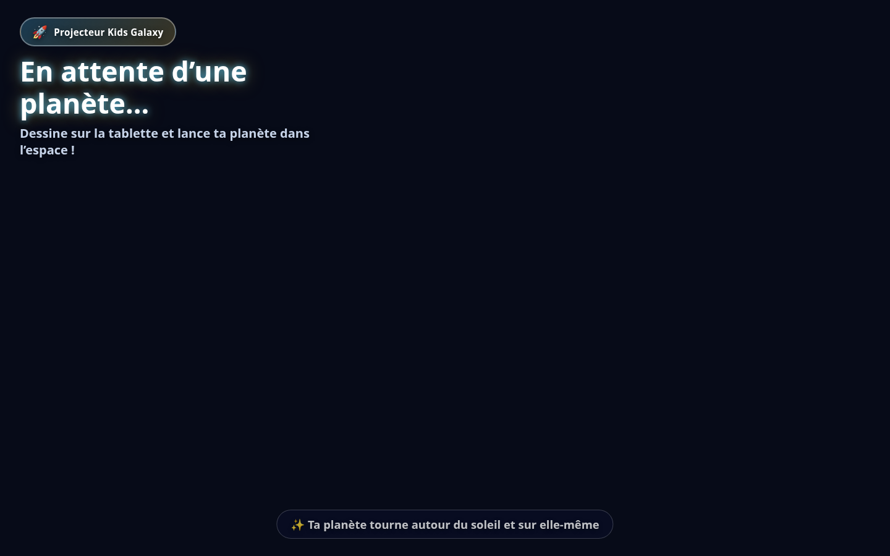

# Installer la salle Kids Galaxy

Cette page est pour le personnel éducateur en garderie.
Les parents et le personnel enseignant peuvent aussi l’utiliser.
Ce n’est pas le guide des programmeurs.
Les notes des programmeurs restent dans `DEVELOPMENT.md`.

La première installation prend environ deux heures.
Un matin à la garderie prend environ dix minutes ensuite.
Faites une étape à la fois.
Vérifiez l’écran après chaque étape.

Cette salle utilise un PC Windows 11.
La version du PC est 26H2.
Ubuntu 22.04 tourne à l’intérieur.
L’utilisateur Linux est `omega`.
Docker démarre avec Ubuntu.
Un routeur de voyage va à chaque garderie.
Les jeunes enfants utilisent la tablette enfant.

<!-- section: who -->

## À qui s’adresse cette page

Vous pouvez le faire si vous savez brancher un câble et coller une ligne.
Une personne-ressource aide la première fois que vous partagez une tablette.
Les enfants ne font pas la première installation.

<!-- section: words -->

## Les mots que nous utilisons

**Ordinateur de la galaxie.** Le PC Windows qui crée l’image du mur.
Ouvrez l’application nommée Ubuntu quand une étape dit de coller une ligne.

**Ubuntu.** L’application de ce PC où vous collez les lignes.
Le nom sur la ligne est `omega`.
Windows appelle cela WSL. Vous pouvez ignorer ces lettres.

**Projecteur.** La boîte qui envoie l’image sur le mur.

**Routeur de voyage.** La petite boîte que vous apportez à chaque garderie.
Son Wi-Fi s’appelle `KidsGalaxy`.
L’adresse du PC sur ce Wi-Fi est `192.168.0.52`.

**Tablette enfant.** La tablette où les enfants dessinent.

**Tablette de gestion.** La tablette d’un adulte.
Elle peut retirer des planètes, imprimer et effacer les noms avant le départ.

**Docker Desktop.** Une application Windows qui doit rester fermée.
Docker dans Ubuntu est celui que cette salle utilise.

**Partage USB.** Le programme `usbipd`.
Il permet à Ubuntu de voir une tablette branchée au PC.
Ubuntu ne voit pas ce câble tout seul.

**Carte papier.** La feuille avec le nom du Wi-Fi, le mot de passe et l’adresse du PC.

**HDMI.** La prise de métal plate du câble d’image.

<!-- section: buy -->

## Quoi avoir sous la main

Rassemblez chaque article avant le jour de l’installation.

<!-- step: buy-kid-tablet -->

1. Une tablette Android pour les enfants.
   Elle doit avoir Android 8 ou plus récent.
   Un écran de 10 pouces est plus facile pour les petites mains.
   Elle doit permettre un effacement complet.

   **Ce que vous devez voir.** La boîte indique Android 8 ou plus récent.

   **Sinon.** Choisissez une autre tablette avant le jour de l’installation.

<!-- step: buy-manager-tablet -->

2. Une tablette Android pour un adulte.
   Elle suit les mêmes règles que la tablette enfant.
   Ne prévoyez pas de verrouiller celle-ci.

   **Ce que vous devez voir.** La tablette s’allume.

   **Sinon.** Chargez-la avec son propre chargeur.

<!-- step: buy-computer -->

3. Utilisez le PC Windows 11 de cette salle.
   Il lui faut un port HDMI, ou un USB-C plus un adaptateur HDMI.
   Il doit ouvrir Chrome.
   Vous n’achetez pas un deuxième ordinateur.

   **Ce que vous devez voir.** Windows montre un bureau.

   **Sinon.** Demandez de l’aide avant le jour de l’installation.

<!-- step: buy-router -->

4. Un routeur de voyage.
   Cette salle utilise celui qui est réglé sur `KidsGalaxy`.
   Il doit réserver `192.168.0.52` pour ce PC.
   Le premier réglage du routeur est sur la page de production.

   **Ce que vous devez voir.** Le routeur peut fonctionner sur USB-C ou une batterie.

   **Sinon.** Utilisez la page de production avant la première visite.

<!-- step: buy-projector -->

5. Un projecteur avec un port HDMI.
   Plus il est lumineux, mieux c’est si les lumières restent allumées.

   **Ce que vous devez voir.** Le projecteur a un port HDMI.

   **Sinon.** Achetez un projecteur qui en a un.

<!-- step: buy-hdmi -->

6. Un câble HDMI assez long pour atteindre le projecteur.
   Achetez un adaptateur USB-C vers HDMI si le PC n’a pas de port HDMI.

   **Ce que vous devez voir.** La prise entre dans le projecteur.

   **Sinon.** Rapportez-la et prenez la bonne prise.

<!-- step: buy-power -->

7. Les câbles d’alimentation du PC, du projecteur et des deux tablettes.
   Apportez deux chargeurs de tablette.

   **Ce que vous devez voir.** Chaque appareil a son propre cordon.

   **Sinon.** Ne partagez pas un petit chargeur de téléphone avec la tablette enfant.

<!-- step: buy-wifi -->

8. Le routeur de voyage est le seul réseau.
   N’utilisez pas le Wi-Fi de la garderie.
   Laissez le point d’accès Windows éteint.
   Ce point d’accès utilise toujours `192.168.137.1`.
   Il refuse souvent de démarrer sans internet à partager.
   Il s’éteint aussi quand la dernière tablette part.

   **Ce que vous devez voir.** La carte papier indique `KidsGalaxy` et `192.168.0.52`.

   **Sinon.** Remplissez la carte avant de quitter la maison.

<!-- step: buy-usb -->

9. Un câble USB qui peut transporter des données.
   Un câble de charge seule ne prépare pas une tablette.

   **Ce que vous devez voir.** L’emballage dit données, ou c’est le câble de la boîte.

   **Sinon.** Achetez un câble de données avant le jour de l’installation.

<!-- section: unpack -->

## Déballer la boîte

Environ 15 minutes.

<!-- step: unpack-check -->

1. Posez chaque article sur une table.
   Cochez la liste ci-dessus.

   **Ce que vous devez voir.** Chaque article est sur la table.

   **Sinon.** Arrêtez-vous tant que le câble ou le bloc manquant n’est pas trouvé.

<!-- step: unpack-charge -->

2. Branchez les deux tablettes sur leurs chargeurs.

   **Ce que vous devez voir.** Une image de pile sur chaque tablette.

   **Sinon.** Changez le câble et enfoncez-le bien.

<!-- section: place -->

## Placer les choses dans la salle

Environ 20 minutes.

<!-- step: place-wall -->

1. Choisissez un mur vide que les enfants peuvent voir.
   Gardez les fenêtres très claires hors de l’image si vous le pouvez.

   **Ce que vous devez voir.** Un espace libre sur le mur.

   **Sinon.** Déplacez le projecteur jusqu’à ce que le faisceau touche un mur vide.

<!-- step: place-projector -->

2. Posez le projecteur sur une table stable.
   Pointez-le vers le mur.
   Laissez de l’espace pour que personne ne traverse le faisceau.

   **Ce que vous devez voir.** Le projecteur reste immobile.

   **Sinon.** Retirez-le d’une chaise molle ou d’un chariot instable.

<!-- step: place-computer -->

3. Placez le PC à côté du projecteur.
   Branchez le HDMI dans le PC et dans le projecteur.

   **Ce que vous devez voir.** Les deux prises sont enfoncées à fond.

   **Sinon.** Poussez chaque prise jusqu’à l’arrêt.

<!-- step: place-router -->

4. Branchez le routeur de voyage.
   Utilisez le courant du mur ou la batterie externe.
   Ne le branchez pas au réseau de la garderie.

   **Ce que vous devez voir.** Un voyant Wi-Fi stable sur le routeur.

   **Sinon.** Vérifiez la prise ou la batterie externe.

<!-- step: place-power -->

5. Branchez le PC et le projecteur au mur.
   Allumez les deux.
   Appuyez sur le bouton source jusqu’à HDMI.

   **Ce que vous devez voir.** Le bureau Windows est sur le mur.

   **Sinon.** Essayez l’autre port HDMI ou un deuxième câble.

<!-- step: place-wifi -->

6. Sur le PC, ouvrez la liste Wi-Fi.
   Joignez `KidsGalaxy`.
   Utilisez le mot de passe de la carte papier.
   Ne joignez pas le Wi-Fi de la garderie.

   **Ce que vous devez voir.** Le nom du Wi-Fi est `KidsGalaxy`.

   **Sinon.** Oubliez les autres réseaux, puis joignez `KidsGalaxy` de nouveau.

<!-- photo: room-layout -->

> **Photo à prendre.** Le projecteur face à un mur vide, avec le PC à côté.

<!-- photo: hdmi-plug -->

> **Photo à prendre.** Un doigt qui pousse la prise HDMI dans le projecteur jusqu’à l’arrêt.

<!-- fix: place -->

> **Si cela ne fonctionne pas**
>
> 1. Vérifiez les deux voyants d’alimentation.
> 2. Poussez la prise HDMI jusqu’au clic.
> 3. Appuyez sur le bouton source jusqu’à HDMI.
> 4. Si le nom Wi-Fi n’est pas `KidsGalaxy`, arrêtez-vous et joignez ce réseau.

<!-- section: computer -->

## Démarrer l’ordinateur de la galaxie

Environ 30 minutes la première fois.
Collez une ligne à la fois.
Appuyez sur Entrée après chaque ligne.

<!-- step: computer-docker -->

1. Quittez Docker Desktop avant toute ligne d’installation.
   Si vous voyez une icône de baleine, faites un clic droit.
   Choisissez Quitter Docker Desktop.
   Ouvrez les applications de démarrage de Windows.
   Éteignez Docker Desktop pour qu’il ne parte pas à l’ouverture de session.

   **Ce que vous devez voir.** L’icône de baleine a disparu.

   **Sinon.** L’installation s’arrête si Docker Desktop tourne encore.

<!-- step: computer-ubuntu -->

2. Cliquez sur Démarrer, tapez `Ubuntu`, et ouvrez cette application.

   **Ce que vous devez voir.** Une fenêtre avec le nom `omega`.

   **Sinon.** Fermez la fenêtre et rouvrez Ubuntu. N’utilisez pas une fenêtre qui dit `root`.

<!-- photo: terminal -->

> **Photo à prendre.** La fenêtre Ubuntu avec le nom omega.

<!-- step: computer-folder -->

3. Collez cette ligne.

```bash
cd /home/omega/kids-galaxy-projector
```

   Puis collez cette ligne.

```bash
pwd
```

   **Ce que vous devez voir.** `/home/omega/kids-galaxy-projector`

   **Sinon.** Vous êtes dans le mauvais dossier. Collez la première ligne de nouveau.

<!-- step: computer-address -->

4. Collez cette ligne.

```bash
hostname -I
```

   **Ce que vous devez voir.** `192.168.0.52`

   **Sinon.** Le PC est sur le mauvais réseau.
   Joignez `KidsGalaxy` dans Windows.
   Lancez `wsl --shutdown` dans PowerShell, ouvrez Ubuntu, et vérifiez de nouveau.
   Ne continuez pas tant que vous ne voyez pas `192.168.0.52`.

<!-- step: computer-host -->

5. Collez cette ligne.

```bash
bash scripts/setup_host.sh
```

   Tapez le mot de passe Ubuntu de `omega` s’il le demande.
   Vous ne verrez pas les lettres.

   **Ce que vous devez voir.** `The galaxy computer programs are installed.`

   **Sinon.** Si Docker Desktop tourne encore, la ligne s’arrête.
   Vous devriez voir `Docker Desktop is running on Windows.`
   Quittez Docker Desktop, puis collez la même ligne de nouveau.

<!-- step: computer-reopen -->

6. Fermez la fenêtre Ubuntu.
   Ouvrez Ubuntu de nouveau depuis Démarrer.

   **Ce que vous devez voir.** Le nom `omega` est revenu.

   **Sinon.** Redémarrez le PC, ouvrez la session, et rouvrez Ubuntu.

<!-- step: computer-return -->

7. Collez cette ligne de nouveau.

```bash
cd /home/omega/kids-galaxy-projector
```

   **Ce que vous devez voir.** Aucune erreur.

   **Sinon.** Collez `pwd` et vérifiez le dossier avant de continuer.

<!-- step: computer-setup -->

8. Collez cette ligne.

```bash
bash scripts/setup_room.sh
```

   Attendez. Le premier passage peut prendre plusieurs minutes.

   **Ce que vous devez voir.** `The galaxy computer is running.`
   Vous devriez aussi voir `https://192.168.0.52:8443`.
   Écrivez cette adresse sur la carte papier.

   **Sinon.** Si le PC n’est pas à `192.168.0.52`, l’installation s’arrête.
   Les tablettes gardent `192.168.0.52`.
   Joignez `KidsGalaxy`, puis relancez la même ligne.
   Ne changez pas l’adresse, sauf si une personne-ressource veut vraiment déplacer la salle.
   Cette personne utilise `CHANGE_ADDRESS=1` et un nouveau `SERVER_IP`.
   Ensuite, les applications des tablettes doivent être reconstruites.

<!-- step: computer-spare -->

9. Laissez le point d’accès Windows éteint.
   Ne collez pas le script Linux de point d’accès.
   Ubuntu refuse ce script, car il ne possède pas la carte Wi-Fi.

   **Ce que vous devez voir.** Le PC reste sur `KidsGalaxy`.

   **Sinon.** Éteignez le point d’accès Windows et joignez `KidsGalaxy` de nouveau.

<!-- fix: computer -->

> **Si cela ne fonctionne pas**
>
> 1. Lisez les dernières lignes dans Ubuntu. Elles nomment ce qui manque.
> 2. Si Docker Desktop tourne, quittez-le et relancez la ligne de l’hôte.
> 3. Si l’adresse n’est pas `192.168.0.52`, joignez le routeur de voyage.
> 4. L’installation garde l’adresse des tablettes. Elle ne suit pas un réseau de garderie.

<!-- section: picture -->

## Afficher l’image

Environ 5 minutes.
Restez dans le dossier du projet.

<!-- step: picture-open -->

1. Collez cette ligne.

```bash
bash scripts/open_projector.sh
```

   Chrome s’ouvre dans Windows.

   **Ce que vous devez voir.** Un ciel sombre et les mots `Projecteur Kids Galaxy`.
   Un raccourci de bureau nommé `Kids Galaxy wall` est aussi créé.

   **Sinon.** Dans Windows, ouvrez Chrome et allez à `http://127.0.0.1:8000/`.

<!-- step: picture-full -->

2. Appuyez sur F11 si l’image ne remplit pas le mur.

   **Ce que vous devez voir.** Les mots d’attente sont sur le mur.

   **Sinon.** Appuyez sur la touche Windows et P. Choisissez Deuxième écran uniquement.

<!-- photo: projector-words -->



Les étoiles remplissent le reste du mur quand l’image est en direct.
Cette photo montre seulement les mots, pour vérifier la langue.

<!-- fix: picture -->

> **Si cela ne fonctionne pas**
>
> 1. Dans Windows, ouvrez `http://127.0.0.1:8000/health`.
>    Vous devriez voir le mot ok.
> 2. Sinon, retournez dans le dossier du projet et lancez `bash scripts/setup_room.sh`.
> 3. Vérifiez le câble HDMI et le bouton source du projecteur.

<!-- section: usb -->

## Laisser Ubuntu voir la tablette

Faites ceci avant d’installer une application.
Une tablette branchée au PC n’est pas visible dans Ubuntu tant que vous ne la partagez pas.
Vous installez le programme de partage une seule fois.
Vous attachez la tablette chaque fois que vous la branchez.

<!-- step: usb-admin -->

1. Faites un clic droit sur Démarrer et ouvrez Terminal (Admin) ou PowerShell (Admin).

   **Ce que vous devez voir.** Le titre dit Administrateur.

   **Sinon.** Fermez la fenêtre et rouvrez la fenêtre administrateur.

<!-- step: usb-install -->

2. Collez cette ligne une fois.

```powershell
winget install --exact --id dorssel.usbipd-win --accept-package-agreements --accept-source-agreements
```

   **Ce que vous devez voir.** L’installation se termine.

   **Sinon.** Choisissez Oui si Windows le demande. Puis collez la ligne de nouveau.

<!-- step: usb-ubuntu -->

3. Ouvrez Ubuntu et laissez cette fenêtre ouverte.

   **Ce que vous devez voir.** Le nom `omega`.

   **Sinon.** L’étape de partage a besoin qu’Ubuntu soit éveillé.

<!-- step: usb-plug -->

4. Branchez le câble de données à la tablette et au PC.
   Utilisez le même port USB chaque fois.

   **Ce que vous devez voir.** La tablette montre une pile ou un avis USB.

   **Sinon.** Essayez un autre port et un câble de données.

<!-- step: usb-allow -->

5. Sur la tablette, touchez Autoriser.

   **Ce que vous devez voir.** Une coche que le débogage USB est permis.

   **Sinon.** Déverrouillez la tablette et touchez Autoriser de nouveau.

<!-- step: usb-list -->

6. Dans la fenêtre PowerShell administrateur, collez cette ligne.

```powershell
usbipd list
```

   **Ce que vous devez voir.** Une ligne pour la tablette, avec un code court comme `2-1`.

   **Sinon.** Débranchez la tablette, rebranchez-la, et collez la ligne de nouveau.

<!-- step: usb-bind -->

7. Écrivez ce code sur la carte papier.
   Collez la ligne suivante avec votre code à la place de `2-1`.

```powershell
usbipd bind --busid 2-1
```

   **Ce que vous devez voir.** La commande se termine.
   Cette ligne n’affiche pas de liste.

   **Sinon.** La fenêtre n’est pas une fenêtre administrateur.

<!-- step: usb-bind-list -->

8. Collez cette ligne de nouveau.

```powershell
usbipd list
```

   **Ce que vous devez voir.** La ligne de la tablette dit Shared.

   **Sinon.** Vérifiez le code sur la carte papier et relancez la ligne de liaison.

<!-- step: usb-attach -->

9. Collez la ligne suivante avec le même code.

```powershell
usbipd attach --wsl --busid 2-1 --distribution Ubuntu
```

   **Ce que vous devez voir.** La commande se termine.
   Cette ligne n’affiche pas de liste.

   **Sinon.** Ouvrez Ubuntu, puis collez la ligne d’attache de nouveau.

<!-- step: usb-attach-list -->

10. Collez cette ligne de nouveau.

```powershell
usbipd list
```

   **Ce que vous devez voir.** La ligne de la tablette dit Attached.

   **Sinon.** Collez la ligne d’attache de nouveau, puis collez `usbipd list`.

<!-- step: usb-see -->

11. Dans Ubuntu, collez cette ligne.

```bash
adb devices
```

   **Ce que vous devez voir.** Une ligne qui finit par `device`.

   **Sinon.** Touchez Autoriser sur la tablette, attachez de nouveau, et collez `adb devices`.

<!-- fix: usb -->

> **Si cela ne fonctionne pas**
>
> 1. Une seule tablette peut être branchée.
> 2. Si Ubuntu dit qu’aucune tablette n’est prête, répétez l’étape d’attache.
> 3. Utilisez le même port USB pour que le code de la carte papier reste bon.

<!-- section: tablets -->

## Préparer les tablettes

Environ 40 minutes la première fois.
Sautez cette partie si les deux applications sont déjà installées.
Chaque ligne Ubuntu commence dans le dossier du projet.

<!-- step: tablets-skip -->

1. Regardez chaque tablette.
   La tablette enfant devrait montrer l’application de dessin.
   La tablette de gestion devrait montrer Gestionnaire Kids Galaxy.
   Si les deux sont là, allez à la section du verrou.

   **Ce que vous devez voir.** Les deux applications sont déjà installées.

   **Sinon.** Continuez à l’étape suivante.

<!-- step: tablets-build -->

2. Collez cette ligne.

```bash
cd /home/omega/kids-galaxy-projector && bash scripts/build_tablets.sh
```

   La première construction peut prendre environ 30 minutes.

   **Ce que vous devez voir.** `BUILD SUCCESSFUL`

   **Sinon.** Si les outils Android manquent, une personne-ressource doit installer Android Studio.

<!-- step: tablets-kid -->

3. Effacez la tablette enfant.
   Sautez chaque compte.
   Joignez `KidsGalaxy` quand la tablette le demande.
   Ouvrez Paramètres, puis À propos, et touchez Numéro de build sept fois.
   Revenez, ouvrez Options pour les développeurs, et activez le débogage USB.
   Partagez cette tablette avec Ubuntu, comme dans la section USB.
   Collez cette ligne.

```bash
bash scripts/prepare_kid_tablet.sh
```

   **Ce que vous devez voir.** L’application de dessin remplit l’écran.

   **Sinon.** Si la ligne dit qu’aucune tablette n’est prête, répétez l’étape d’attache.
   Si le mode verrouillé échoue, effacez la tablette et ne vous connectez pas.

<!-- step: tablets-manager -->

4. Débranchez la tablette enfant.
   Branchez la tablette de gestion et touchez Autoriser.
   Partagez-la avec Ubuntu de la même façon.
   Ne l’effacez pas, sauf si vous le voulez.
   Collez cette ligne.

```bash
bash scripts/prepare_manager_tablet.sh
```

   **Ce que vous devez voir.** Gestionnaire Kids Galaxy est dans la liste des applications.
   Cette tablette n’est pas verrouillée.

   **Sinon.** Utilisez un câble de données et touchez Autoriser. Une seule tablette peut être branchée.

<!-- fix: tablets -->

> **Si cela ne fonctionne pas**
>
> 1. Partagez la tablette, puis cherchez une ligne qui finit par `device`.
> 2. Si le mode verrouillé échoue, effacez la tablette enfant et ne vous connectez pas.
> 3. Si l’application se ferme tout de suite, lancez `bash scripts/setup_room.sh`, puis reconstruisez les applications.

<!-- section: lock -->

## Verrouiller la tablette enfant

Environ 15 minutes.
Faites ceci seulement sur la tablette enfant.
La ligne de préparation active déjà le mode verrouillé.
Utilisez cette section si vous devez le refaire.

<!-- step: lock-erase -->

1. Effacez la tablette enfant.
   Sautez chaque compte.
   Joignez `KidsGalaxy`.

   **Ce que vous devez voir.** Un écran d’accueil sans compte de courriel.

   **Sinon.** Effacez la tablette de nouveau.

<!-- step: lock-share -->

2. Activez le débogage USB.
   Branchez seulement la tablette enfant.
   Touchez Autoriser.
   Attachez-la à Ubuntu avec les étapes de partage USB.

   **Ce que vous devez voir.** `adb devices` finit par `device`.

   **Sinon.** Répétez l’étape d’attache avant de continuer.

<!-- step: lock-command -->

3. Dans le dossier du projet, collez cette ligne.

```bash
bash scripts/prepare_kid_tablet.sh
```

   Appuyez sur Accueil.

   **Ce que vous devez voir.** Vous restez dans l’application de dessin.

   **Sinon.** Effacez la tablette, sautez le compte, et relancez la ligne.

<!-- photo: lock-screen -->

> **Photo à prendre.** La tablette enfant qui montre seulement l’application de dessin, sans icônes d’accueil.

<!-- fix: lock -->

> **Si cela ne fonctionne pas**
>
> La cause habituelle est un compte sur la tablette.
> Effacez la tablette de nouveau.
> Ne vous connectez pas.
> Relancez la même commande.

<!-- section: first-planet -->

## Envoyer la première planète

Environ 10 minutes.
La tablette enfant doit être sur `KidsGalaxy`.

<!-- step: first-draw -->

1. Sur la tablette enfant, touchez une forme et tracez quelques lignes.

   **Ce que vous devez voir.** Vos traits sur la tablette.

   **Sinon.** Réveillez la tablette et ouvrez l’application de dessin.

<!-- step: first-launch -->

2. Touchez Lancer.
   Regardez le mur.

   **Ce que vous devez voir.** La nouvelle planète dans le ciel.
   La première planète peut prendre quelques secondes.

   **Sinon.** Vérifiez que le nom Wi-Fi de la tablette est `KidsGalaxy`.

<!-- fix: first-planet -->

> **Si cela ne fonctionne pas**
>
> 1. La tablette et le PC doivent tous les deux montrer `KidsGalaxy`.
> 2. N’utilisez pas le Wi-Fi de la garderie.
> 3. Lisez la page de dépannage si le mur reste vide.

<!-- section: time -->

## Combien de temps prend chaque partie

| Partie | Première fois | Ensuite |
| --- | --- | --- |
| Déballer et placer | 35 minutes | 10 minutes |
| Ordinateur de la galaxie | 30 minutes | 5 minutes |
| Image | 5 minutes | 1 minute |
| Partage et applications | 55 minutes | À sauter |
| Première planète | 10 minutes | 2 minutes |

La page suivante est le guide de tous les jours.
Utilisez-la après que cette installation a fonctionné une fois.

<!-- section: next -->

## Quand la salle doit durer

<!-- step: next-production -->

1. Lisez la page de production après que la première planète fonctionne.
   Elle couvre la réservation du routeur, les copies de secours et les mises à jour.

   **Ce que vous devez voir.** Vous trouvez la section du routeur de voyage sur cette page.

   **Sinon.** Restez sur cette page jusqu’à ce que la première planète apparaisse.

<!-- step: next-kid -->

2. Lisez la page de la tablette enfant avant que les enfants l’utilisent.
   Elle couvre l’étui, le mode verrouillé et la charge.

   **Ce que vous devez voir.** Vous pouvez suivre cette page seule.

   **Sinon.** Faites les étapes d’étui et de verrou avant qu’un enfant utilise la tablette.
