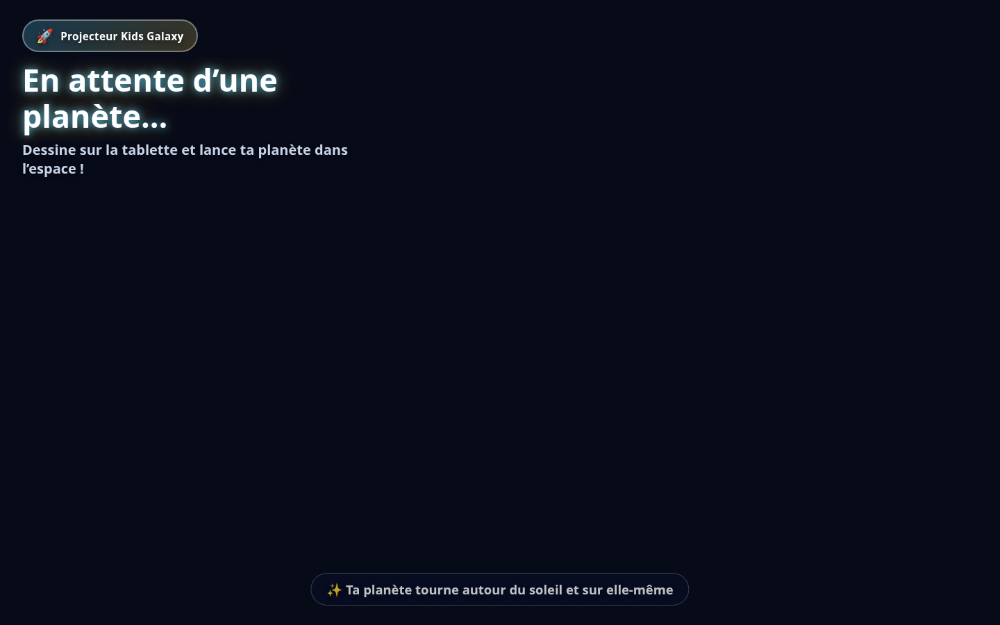

# Installer la salle Kids Galaxy

Cette page est pour les parents, le personnel enseignant et le personnel de la garderie.
Ce n’est pas le guide des programmeurs.
Les notes des programmeurs restent dans `DEVELOPMENT.md`.

La première installation prend environ deux heures.
Un matin normal prend environ dix minutes après cela.
Faites une étape à la fois.
Ne sautez pas une étape qui dit ce que vous devez voir.

<!-- section: who -->

## À qui s’adresse cette page

Vous pouvez le faire si vous savez brancher un câble et copier une ligne.
Une personne-ressource aide pour les étapes de la tablette.
Les enfants ne font pas la première installation.

<!-- section: words -->

## Les mots que nous utilisons

**Ordinateur de la galaxie.** L’ordinateur portable ou de bureau qui crée l’image.
Un Raspberry Pi peut être cet ordinateur.
Un portable donne une image plus fluide.

**Projecteur.** La boîte qui envoie l’image sur le mur.

**Tablette enfant.** La tablette où les enfants dessinent.
L’application de dessin reste à l’écran.

**Tablette de gestion.** La tablette d’un adulte.
Elle peut effacer des planètes, imprimer et changer la langue du mur.

**Mode verrouillé.** La tablette enfant ne peut pas ouvrir d’autres applications.

**Certificat.** Une petite carte d’identité pour une tablette.
Un enfant ne la tape jamais.

**Wi-Fi.** Le lien sans fil de la salle.
L’ordinateur et les tablettes doivent joindre le même réseau.

**Terminal.** La fenêtre où vous collez une commande.
Ouvrez-la dans la liste des applications. Elle peut s’appeler Terminal.

**HDMI.** La prise de métal plate du câble d’image.

**Raspberry Pi.** Un petit ordinateur de la taille d’un jeu de cartes.
Utilisez-le seulement s’il est l’ordinateur de votre ensemble.

<!-- section: buy -->

## Quoi acheter

Achetez chaque article ci-dessous avant le jour de l’installation.
Comptez environ 30 minutes pour tout rassembler.

<!-- step: buy-kid-tablet -->

1. Une tablette Android pour les enfants.
   Elle doit avoir Android 8 ou plus récent.
   Un écran de 10 pouces est plus facile pour les petites mains.
   Elle doit permettre un effacement complet.
   Exemple : une Lenovo Tab ou une Samsung Galaxy Tab récente.

<!-- step: buy-manager-tablet -->

2. Une tablette Android pour un adulte.
   Elle suit les mêmes règles que la tablette enfant.
   Un plus petit écran convient.
   Ne prévoyez pas de verrouiller celle-ci.

<!-- step: buy-computer -->

3. Un portable ou un ordinateur de bureau sous Linux.
   Il lui faut un port HDMI, ou un port USB-C plus un adaptateur HDMI.
   Il lui faut 8 Go de mémoire ou plus.
   Il doit ouvrir Chrome.
   C’est le meilleur ordinateur de la galaxie.

<!-- step: buy-pi -->

4. Un Raspberry Pi seulement si votre liste d’ensemble le nomme.
   Achetez aussi le bloc d’alimentation de la boîte du Pi.
   Un chargeur de téléphone est souvent trop faible.
   Le Pi a besoin d’un câble d’écran s’il est le seul ordinateur.
   Préférez un portable quand vous avez le choix.

<!-- step: buy-projector -->

5. Un projecteur avec un port HDMI.
   Plus il est lumineux, mieux c’est si les lumières restent allumées.
   Le 1080p suffit.

<!-- step: buy-hdmi -->

6. Un câble HDMI.
   Il doit aller de l’ordinateur au projecteur.
   Achetez un adaptateur USB-C vers HDMI si l’ordinateur n’a pas de port HDMI.

<!-- step: buy-power -->

7. Les câbles d’alimentation pour l’ordinateur, le projecteur et les deux tablettes.
   Deux chargeurs de tablette.

<!-- step: buy-wifi -->

8. Un réseau Wi-Fi privé.
   Internet n’est pas nécessaire après l’installation.
   L’ordinateur et les deux tablettes doivent joindre ce même réseau.

<!-- step: buy-usb -->

9. Un câble USB qui peut transporter des données.
   Un câble de charge seule ne prépare pas une tablette.
   Vous l’utilisez une fois, de l’ordinateur vers chaque tablette.

<!-- section: unpack -->

## Déballer la boîte

Environ 15 minutes.

<!-- step: unpack-check -->

1. Placez chaque article sur une table.
   Cochez la liste d’achat ci-dessus.
   Arrêtez-vous s’il manque un câble ou un bloc d’alimentation.

<!-- step: unpack-charge -->

2. Branchez les deux tablettes sur leur chargeur.
   Laissez-les charger pendant la préparation de l’ordinateur.
   Vous devriez voir une image de pile sur chaque tablette.

> **Si cela ne fonctionne pas**
>
> Changez de câble USB.
> Certains câbles ne chargent que lorsqu’ils sont bien enfoncés.
> Essayez l’autre chargeur.

<!-- section: place -->

## Placer le matériel

Environ 20 minutes.

<!-- step: place-wall -->

1. Choisissez un mur vide.
   Les enfants doivent pouvoir le voir de leur place.
   Évitez une fenêtre très claire dans l’image si vous le pouvez.

<!-- step: place-projector -->

2. Posez le projecteur sur une tablette stable ou une table.
   Pointez-le vers le mur.
   Laissez de l’espace pour que personne ne traverse le faisceau.

<!-- step: place-computer -->

3. Placez l’ordinateur de la galaxie à côté du projecteur.
   Branchez le câble HDMI dans l’ordinateur et dans le projecteur.
   Choisissez l’entrée HDMI sur le projecteur.

<!-- step: place-pi -->

4. Si l’ordinateur est un Raspberry Pi, faites aussi ceci.
   Utilisez le bloc d’alimentation fourni avec le Pi.
   Branchez le petit cordon d’alimentation dans le Pi.
   Branchez le HDMI du Pi vers le projecteur.
   Vous devriez voir un bureau, pas un écran noir.

<!-- step: place-power -->

5. Branchez l’ordinateur et le projecteur au mur.
   Allumez le projecteur.
   Allumez l’ordinateur.
   Vous devriez voir l’écran de l’ordinateur sur le mur.

<!-- step: place-wifi -->

6. Joignez le Wi-Fi de la salle sur l’ordinateur.
   Vous joindrez le même Wi-Fi sur les tablettes plus tard.
   Vous devriez voir une icône Wi-Fi qui ne clignote pas.

<!-- photo: room-layout -->

> **Photo à prendre :** le projecteur face à un mur vide, avec l’ordinateur à côté.

<!-- photo: hdmi-plug -->

> **Photo à prendre :** un doigt qui pousse la prise HDMI dans le projecteur jusqu’au bout.

<!-- fix: place -->

> **Si cela ne fonctionne pas**
>
> 1. Vérifiez les deux voyants d’alimentation.
> 2. Poussez la prise HDMI jusqu’au clic.
> 3. Appuyez sur le bouton source du projecteur jusqu’à HDMI.
> 4. Si le Pi n’a pas de bureau, la carte mémoire n’est pas prête. Demandez de l’aide.

<!-- section: computer -->

## Démarrer l’ordinateur de la galaxie

Environ 30 minutes la première fois.
Vous tapez des commandes dans Terminal.
Ouvrez Terminal dans la liste des applications.
Collez une ligne, puis appuyez sur Entrée.

<!-- step: computer-terminal -->

1. Ouvrez Terminal sur l’ordinateur de la galaxie.
   Vous devriez voir un curseur qui clignote.

<!-- photo: terminal -->

> **Photo à prendre :** la fenêtre Terminal avec le curseur qui clignote.

<!-- step: computer-docker -->

2. Si Docker n’est pas encore installé, collez cette ligne et appuyez sur Entrée.

```bash
sudo apt-get update && sudo apt-get install -y docker.io docker-compose-v2 openssl
```

   Tapez le mot de passe de l’ordinateur s’il le demande.
   Vous ne verrez pas les lettres. Appuyez sur Entrée.
   Puis collez cette ligne.

```bash
sudo usermod -aG docker "$USER"
```

   Déconnectez-vous, puis reconnectez-vous.
   Vous devriez revoir le bureau.

<!-- step: computer-setup -->

3. Allez dans le dossier du projet dans Terminal.
   Collez cette ligne si le dossier est dans votre dossier personnel.

```bash
cd "$HOME/kids-galaxy-projector" && bash scripts/setup_room.sh
```

   Attendez. Le premier passage peut prendre plusieurs minutes.
   Vous devriez voir les mots `The galaxy computer is running.`
   Vous devriez aussi voir une adresse comme `https ://192.168.1.20:8443`.
   Écrivez cette adresse sur papier.

<!-- step: computer-pi -->

4. Utilisez la même commande si l’ordinateur est un Raspberry Pi.
   Le Pi doit déjà montrer un bureau.
   N’utilisez pas un chargeur de téléphone.
   Vous devriez voir le même message de démarrage.

<!-- step: computer-hotspot -->

5. Faites cette étape seulement si la salle n’a pas de Wi-Fi.
   Collez cette ligne.

```bash
sudo bash scripts/setup_hotspot.sh
```

   Vous devriez voir le nom Wi-Fi `KidsGalaxy`.
   Le script affiche un nouveau mot de passe.
   Écrivez ce mot de passe sur papier.
   L’adresse est habituellement `10.42.0.1`.
   Joignez ce Wi-Fi sur les deux tablettes plus tard.

<!-- fix: computer -->

> **Si cela ne fonctionne pas**
>
> 1. Lisez les dernières lignes dans Terminal. Elles disent ce qui manque.
> 2. Si Docker manque, répétez l’étape Docker et reconnectez-vous.
> 3. S’il n’y a pas d’adresse réseau, joignez le Wi-Fi et relancez l’installation.
> 4. Si l’adresse change plus tard, collez `NEW_CERTIFICATES=1 bash scripts/setup_room.sh`.
>    Puis reconstruisez les applications. Les anciennes ne correspondront plus.

<!-- section: picture -->

## Afficher l’image

Environ 5 minutes.

<!-- step: picture-open -->

1. Dans Terminal, collez cette ligne.

```bash
bash scripts/open_projector.sh
```

   Vous devriez voir un ciel sombre et les mots `Projecteur Kids Galaxy`.
   Si Chrome ne s’ouvre pas, ouvrez Chrome vous-même.
   Allez à `http ://127.0.0.1:8000/`.

<!-- step: picture-full -->

2. Appuyez sur F11 pour que l’image remplisse l’écran.
   Vous devriez voir les mots d’attente sur le mur.

<!-- photo: projector-words -->

 

Les étoiles remplissent le reste du mur quand l’image est en direct.
Cette photo montre seulement les mots, pour vérifier la langue.

<!-- fix: picture -->

> **Si cela ne fonctionne pas**
>
> 1. Sur cet ordinateur, ouvrez `http ://127.0.0.1:8000/health`.
>    Vous devriez voir le mot ok.
> 2. Sinon, lancez de nouveau `bash scripts/setup_room.sh`.
> 3. Vérifiez le câble HDMI et le bouton source du projecteur.

<!-- section: tablets -->

## Préparer les tablettes

Environ 40 minutes la première fois.
Sautez cette partie si les deux applications sont déjà installées pour cette salle.

<!-- step: tablets-skip -->

1. Regardez chaque tablette.
   La tablette enfant devrait avoir l’application de dessin.
   La tablette adulte devrait avoir Gestionnaire Kids Galaxy.
   Si les deux sont là, passez à la section du verrou.

<!-- step: tablets-build -->

2. Sur l’ordinateur de la galaxie, collez cette ligne.

```bash
bash scripts/build_tablets.sh
```

   La première construction peut prendre environ 30 minutes.
   Vous devriez voir `BUILD SUCCESSFUL`.
   Si les outils Android manquent, une personne-ressource doit installer Android Studio.

<!-- step: tablets-kid -->

3. Effacez la tablette enfant avant d’installer l’application.
   N’ajoutez pas de compte Google quand la tablette le demande.
   Activez le débogage USB.
   Ouvrez Paramètres, puis À propos de la tablette, puis touchez Numéro de build sept fois.
   Revenez. Ouvrez Options pour les développeurs. Activez le débogage USB.
   Branchez la tablette enfant à l’ordinateur.
   Sur la tablette, touchez Autoriser.
   Collez cette ligne.

```bash
bash scripts/prepare_kid_tablet.sh
```

   Vous devriez voir l’application de dessin remplir l’écran.

<!-- step: tablets-manager -->

4. Débranchez la tablette enfant.
   Branchez la tablette de gestion.
   Touchez Autoriser.
   N’effacez pas cette tablette, sauf si vous le voulez.
   Collez cette ligne.

```bash
bash scripts/prepare_manager_tablet.sh
```

   Vous devriez voir Gestionnaire Kids Galaxy dans la liste des applications.
   Cette tablette ne doit pas être verrouillée.

<!-- fix: tablets -->

> **Si cela ne fonctionne pas**
>
> 1. Si aucune tablette n’est prête, touchez Autoriser et utilisez un câble de données.
> 2. Si le mode verrouillé échoue, effacez la tablette enfant et ne vous connectez pas.
> 3. Si l’application se ferme tout de suite, la carte d’identité ne correspond pas.
>    Lancez `bash scripts/setup_room.sh`, puis `bash scripts/build_tablets.sh` de nouveau.

<!-- section: lock -->

## Verrouiller la tablette enfant

Environ 15 minutes.
Faites ceci seulement sur la tablette enfant.
La commande de la section tablette active déjà le mode verrouillé.
Utilisez cette section si vous devez le refaire.

<!-- step: lock-erase -->

1. Effacez la tablette enfant.
   Ignorez chaque demande de compte.
   Vous devriez voir un écran d’accueil sans compte de courriel.

<!-- step: lock-usb -->

2. Activez le débogage USB, comme dans la section tablette.
   Branchez le câble USB.
   Touchez Autoriser.

<!-- step: lock-command -->

3. Collez cette ligne.

```bash
bash scripts/prepare_kid_tablet.sh
```

   Appuyez sur le bouton Accueil.
   Vous devriez rester dans l’application de dessin.

<!-- photo: lock-screen -->

> **Photo à prendre :** la tablette enfant qui montre seulement l’application de dessin, sans icônes d’accueil.

<!-- fix: lock -->

> **Si cela ne fonctionne pas**
>
> La cause habituelle est un compte Google sur la tablette.
> Effacez la tablette de nouveau.
> Ne vous connectez pas.
> Lancez la même commande de nouveau.

<!-- section: first-planet -->

## Envoyer la première planète

Environ 10 minutes.

<!-- step: first-draw -->

1. Sur la tablette enfant, touchez une forme.
   Dessinez quelques traits.
   Vous devriez voir vos traits sur la tablette.

<!-- step: first-launch -->

2. Touchez Lancer.
   Regardez le mur.
   Vous devriez voir la nouvelle planète dans le ciel.
   La première vraie planète peut prendre quelques secondes.

<!-- fix: first-planet -->

> **Si cela ne fonctionne pas**
>
> 1. Vérifiez que la tablette est sur le même Wi-Fi que l’ordinateur.
> 2. Ouvrez l’application de dessin et touchez le nom de la galaxie.
> 3. Si vous tapez une adresse, utilisez l’adresse `https ://` de l’installation.
> 4. Lisez la page de dépannage si le mur reste vide.

<!-- section: time -->

## Combien de temps prend chaque partie

| Partie | Première fois | Ensuite |
| --- | --- | --- |
| Déballer et placer | 35 minutes | 5 minutes |
| Ordinateur | 30 minutes | 2 minutes |
| Image | 5 minutes | 1 minute |
| Tablettes et verrou | 55 minutes | À sauter |
| Première planète | 10 minutes | 2 minutes |

La page suivante est le guide de tous les jours.
Utilisez-la après une installation qui a déjà fonctionné.

<!-- section: next -->

## Quand la salle doit durer

<!-- step: next-production -->

1. Lisez la page de mise en production après la première planète.
   Elle couvre les copies de secours, les mises à jour et la tablette enfant.

<!-- step: next-kid -->

2. Lisez la page de la tablette enfant avant que les enfants l’utilisent.
   Elle couvre l’étui, le mode verrouillé et la charge.
